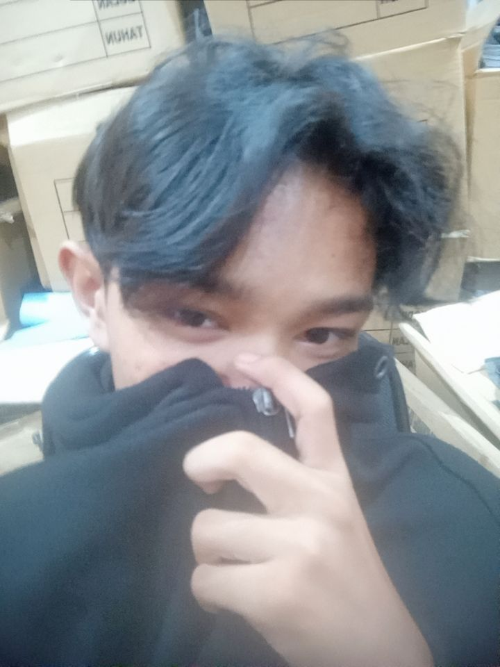
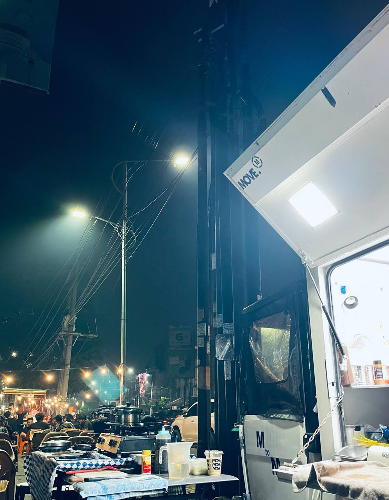

kurangin yapping perbanyak praying

<!DOCTYPE html>
<html lang="id">
<head>
<meta charset="UTF-8">
<meta name="viewport" content="width=device-width, initial-scale=1.0">
<meta name="theme-color" content="#10110f">
<meta name="description" content="Website pribadi REZKY ADITYA, siswa XII TKJ 1 yang menyukai sepak bola, jalan-jalan, dan Formula 1.">
<title>REZKY ADITYA | Personal Website</title>

</head>

<body>

<header>
  
REZKY.

  <nav aria-label="Navigasi utama">
    <a href="#tentang">Profil</a>
    <a href="#hobi">Hobi</a>
    <a href="#kontak">Kontak</a>
  </nav>
</header>

<!-- HALAMAN UTAMA -->
<section class="hero" id="home">
  
✦ PERSONAL WEBSITE

  <h1>
    HALO, 
    SAYA REZKY ADITYA.
  </h1>

  

    Selamat datang di website pribadi saya.
    Kenali saya lebih dekat melalui profil,
    hobi, dan media sosial saya.
  

  

    <a href="#tentang" class="btn">Tentang Saya ↓</a>
    <a href="#kontak" class="btn btn-outline">
      Hubungi Saya
    </a>
  

  <!-- Simpan foto utama dengan nama foto.jpg -->
  
</section>

<!-- PROFIL -->
<section id="tentang">
  
01 — PROFIL

  <h2>Tentang Saya.</h2>

  

    <h3>REZKY ADITYA</h3>

    

      Halo semuanya! Nama saya REZKY ADITYA.
      Saya adalah siswa kelas XII TKJ 1.
      Ini adalah website pribadi saya untuk
      memperkenalkan diri, berbagi hobi,
      dan menunjukkan hal-hal yang saya sukai.
    

  

  

    

      <strong>NAMA LENGKAP</strong>
      REZKY ADITYA
    

    

      <strong>KELAS</strong>
      XII TKJ 1
    

    

      <strong>HOBI</strong>
      Bermain Bola, Jalan jalan, dan Menonton Formula 1
    

  

</section>

<!-- HOBI -->
<section id="hobi">
  
02 — AKTIVITAS

  <h2>Hal yang Saya Suka.</h2>

  

    Tiga hal yang membuat waktu luang saya lebih seru.
  

  

    

      
      <h3>01. Bermain Bola ⚽</h3>
      

        Menikmati permainan sepak bola,
        berolahraga bersama teman,
        dan menjunjung tinggi sportivitas.
      

    

    

      
      <h3>02. Jalan-Jalan 🌄</h3>
      

        Menjelajahi tempat baru, menikmati
        pemandangan, dan mencari pengalaman seru.
      

    

    

      
      <h3>03. Menonton Formula 1 🏎️</h3>
      

        Menikmati balapan, strategi tim,
        kecepatan mobil, dan persaingan
        seru di lintasan Formula 1.
      

    

  

</section>

<!-- KONTAK -->
<section id="kontak">
  
03 — KONTAK

  <h2>Mari Terhubung.</h2>

  

    Terima kasih sudah mengunjungi website saya.
    Kamu bisa menghubungi atau mengikuti saya
    melalui media sosial berikut.
  

  

    

      <strong>WHATSAPP</strong>
      <a href="https://wa.me/6283897256809"
         target="_blank"
         rel="noopener noreferrer">
        0838-9725-6809 ↗
      </a>
    

    

      <strong>INSTAGRAM</strong>
      <a href="https://instagram.com/kyy_cavalry"
         target="_blank"
         rel="noopener noreferrer">
        @kyy_cavalry ↗
      </a>
    

  

  

    <a class="btn"
       href="https://wa.me/6283897256809"
       target="_blank"
       rel="noopener noreferrer">
      Chat WhatsApp
    </a>

    <a class="btn btn-outline"
       href="https://instagram.com/kyy_cavalry"
       target="_blank"
       rel="noopener noreferrer">
      Instagram Saya
    </a>
  

</section>

<footer>
  © 2026 REZKY ADITYA. All rights reserved.
</footer>

</body>
</html>
